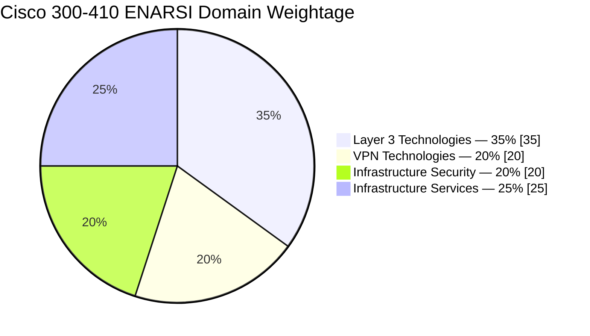
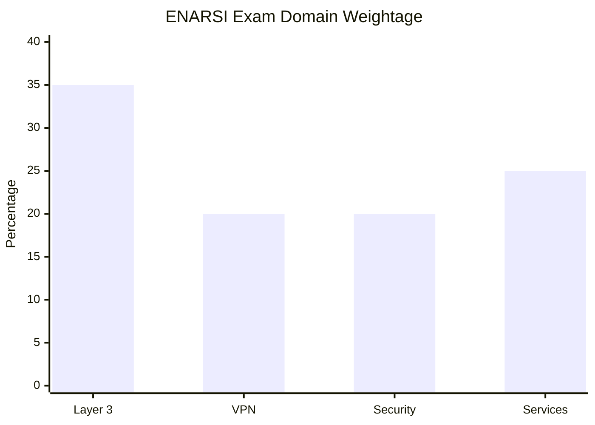
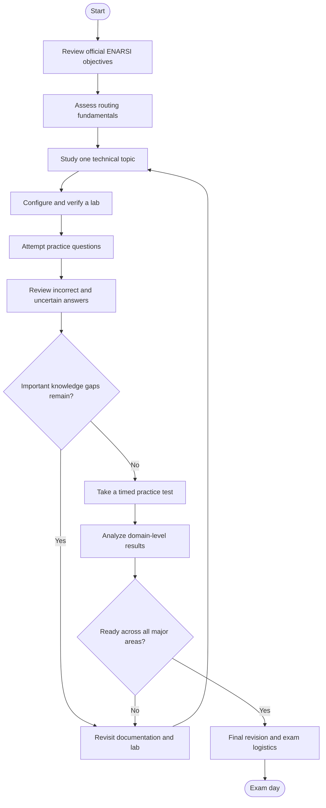
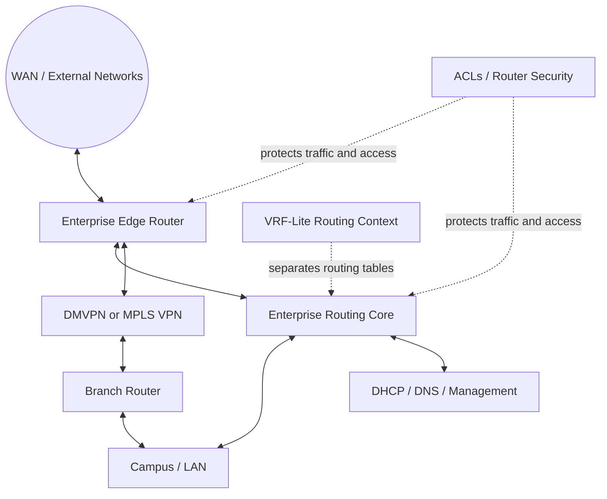
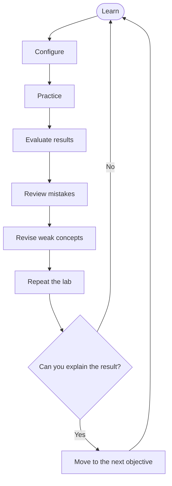
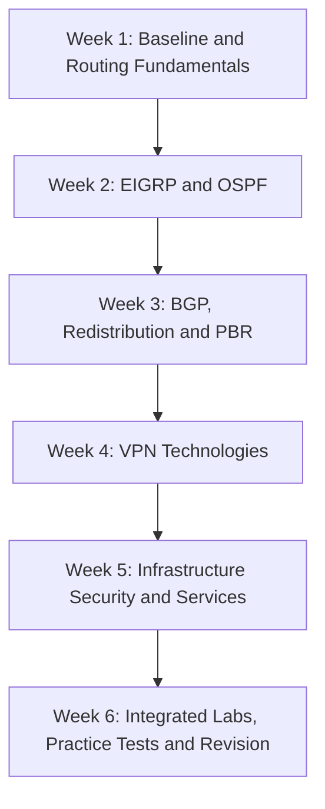
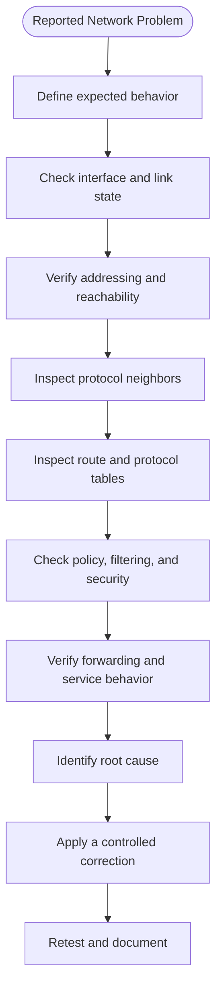

# Cisco 300-410 ENARSI Study Guide

A practical, community-oriented study guide for **Cisco 300-410 ENARSI (Implementing Cisco Enterprise Advanced Routing and Services)**. This repository organizes the major routing, VPN, infrastructure security, and infrastructure services topics into a structured learning path with diagrams, troubleshooting exercises, hands-on lab ideas, and original practice questions.

Whether you are preparing for the ENARSI certification, strengthening your Cisco IOS troubleshooting skills, or building a more reliable understanding of enterprise routing, use this guide alongside the official Cisco exam topics and training resources.

**Exam code:** 300-410 ENARSI  
**Provider:** Cisco  
**Official exam page:** [Cisco 300-410 ENARSI](https://www.cisco.com/site/us/en/learn/training-certifications/exams/enarsi.html)  
**Supplementary preparation:** [CertsGate](https://certsgate.com/)

---

## Table of Contents

- [About the Exam](#about-the-exam)
- [Who Should Use This Guide?](#who-should-use-this-guide)
- [Exam Details](#exam-details)
- [ENARSI Exam Objectives](#enarsi-exam-objectives)
- [Domain Weightage Chart](#domain-weightage-chart)
- [Certification Preparation Flowchart](#certification-preparation-flowchart)
- [Enterprise Routing Architecture](#enterprise-routing-architecture)
- [Study and Revision Cycle](#study-and-revision-cycle)
- [Step-by-Step Preparation Strategy](#step-by-step-preparation-strategy)
- [Six-Week Study Roadmap](#six-week-study-roadmap)
- [Hands-On Labs and Projects](#hands-on-labs-and-projects)
- [Original Practice Questions](#original-practice-questions)
- [Troubleshooting Methodology](#troubleshooting-methodology)
- [Common Preparation Mistakes](#common-preparation-mistakes)
- [Career Relevance](#career-relevance)
- [Frequently Asked Questions](#frequently-asked-questions)
- [Official and Additional Learning Resources](#official-and-additional-learning-resources)
- [About CertsGate](#about-certsgate)
  
---

## About the Exam

The Cisco 300-410 ENARSI exam focuses on implementing and troubleshooting advanced enterprise routing technologies and services. Its scope includes Layer 3 routing, VPN technologies, infrastructure security, and infrastructure services.

Unlike preparation that concentrates only on memorizing commands, effective ENARSI study requires understanding how routing decisions are made, how control-plane relationships are established, and how to isolate faults when a network behaves unexpectedly.

For example, when a route is missing, a useful troubleshooting process should help you determine whether the problem originates in neighbor formation, route advertisement, filtering, redistribution, route selection, or forwarding.

This repository is designed to connect exam preparation with that practical way of thinking.

### What you will find here

- An organized overview of the exam domains.
- Mermaid diagrams illustrating routing relationships and study workflows.
- A suggested study roadmap.
- Lab ideas for EIGRP, OSPF, BGP, redistribution, VPNs, and infrastructure services.
- Original practice questions with explanations.
- Links to Cisco's official exam and training resources.
- Supplementary independent preparation resources.

## Who Should Use This Guide?

This study guide is useful for:

- Network engineers preparing for the 300-410 ENARSI certification.
- Network administrators working with enterprise routing.
- Network support technicians developing troubleshooting skills.
- Candidates who have studied foundational routing and want more advanced practice.
- IT professionals working with Cisco IOS, IPv4, IPv6, routing protocols, and network services.

Cisco lists no formal prerequisite for the ENARSI training. However, it recommends familiarity with network fundamentals, LAN implementation, network device management and security, routing protocols, and basic network automation.

If EIGRP, OSPF, BGP, ACLs, DHCP, or subnetting are unfamiliar, review those fundamentals before moving into advanced troubleshooting.

---

## Exam Details

The following details are based on Cisco's published exam information.

| Item | Details |
|---|---|
| Exam code | 300-410 ENARSI |
| Official exam name | Implementing Cisco Enterprise Advanced Routing and Services |
| Provider | Cisco |
| Exam duration | 90 minutes |
| Languages listed by Cisco | English and Japanese |
| Published price | US$300, or Cisco Learning Credits |
| Related certification | Cisco Certified Specialist – Enterprise Advanced Infrastructure Implementation |
| CCNP Enterprise pathway | Can fulfill the concentration exam requirement when combined with the required core exam |
| Official topic reference | Cisco ENARSI exam topics |

Cisco does not provide a universal fixed passing score or a guaranteed question count in the exam overview referenced here. Do not rely on unofficial claims about these details.

Check the [official exam page](https://www.cisco.com/site/us/en/learn/training-certifications/exams/enarsi.html) for current scheduling and exam information.

---

## ENARSI Exam Objectives

Cisco's published ENARSI exam topics organize the exam into four weighted domains. The following overview reflects the published ENARSI v1.1 topic outline. Always check the current official blueprint before beginning a new study cycle.

### 1. Layer 3 Technologies — 35%

This is the largest domain in the published blueprint.

Focus areas include:

- Administrative distance and route selection.
- Route maps, filtering, route tagging, and loop prevention.
- Route redistribution between routing protocols.
- Manual and automatic summarization.
- Policy-based routing (PBR).
- VRF-Lite.
- Bidirectional Forwarding Detection (BFD).
- EIGRP configuration and troubleshooting.
- OSPFv2 and OSPFv3.
- Internal and external BGP.
- IPv4 and IPv6 routing.
- Neighbor relationships, authentication, metrics, and path selection.

**Practical goal:** Explain why a route is or is not installed, identify where routing information is lost, and verify that the selected path matches the intended design.

### 2. VPN Technologies — 20%

Focus areas include:

- Multiprotocol Label Switching (MPLS).
- MPLS Layer 3 VPN architecture.
- MPLS VPN routing and packet forwarding.
- VRF concepts associated with VPN environments.
- Dynamic Multipoint VPN (DMVPN).

**Practical goal:** Understand how traffic is separated, how VPN components exchange routing information, and how to trace a packet through a VPN path.

### 3. Infrastructure Security — 20%

Prepare for the security features and troubleshooting concepts specified in the official topic outline, including router security and IPv6 first-hop security.

Useful supporting concepts include:

- Access control lists (ACLs).
- Router management-plane protection.
- IPv6 first-hop security mechanisms.
- Unicast Reverse Path Forwarding (uRPF).
- Authentication and infrastructure access controls.

**Practical goal:** Identify whether a security feature is blocking legitimate traffic or failing to enforce the intended policy.

### 4. Infrastructure Services — 25%

Focus on the services and operational tools covered by the current official blueprint and related Cisco training materials.

Relevant study areas include:

- DHCPv4 and DHCPv6.
- Infrastructure management and monitoring.
- Syslog and logging.
- SNMP and NetFlow concepts.
- IP SLA.
- Authentication, authorization, and accounting (AAA).
- Control Plane Policing (CoPP).
- Cisco network assurance and troubleshooting tools.

**Practical goal:** Diagnose service failures using configuration checks, operational state, logs, and verification commands.

For the complete task-level objectives, consult the [official Cisco exam topics](https://learningnetwork.cisco.com/s/enarsi-exam-topics).

---

## Domain Weightage Chart

The percentages below come from Cisco's published ENARSI v1.1 exam topic document. They are exam-domain weights, not a prediction of the exact number of questions on an individual exam delivery.

### Domain distribution



### Weight comparison



### How to use the chart

- Give Layer 3 Technologies substantial study time because it has the largest published weight.
- Keep VPN Technologies and Infrastructure Security in the schedule; each represents one-fifth of the published blueprint.
- Do not neglect Infrastructure Services, which represents one-quarter of the published weight.
- Use your own practice results to decide which topics need additional revision.

A domain's weight is not a substitute for understanding its objectives. Build both broad coverage and troubleshooting depth.

---

## Certification Preparation Flowchart

Use this workflow to guide your ENARSI preparation. The revision loop is important: a weak area should send you back to targeted study rather than straight to another mock test.



A strong preparation process combines official objectives, conceptual study, hands-on configuration, practice questions, and systematic mistake analysis.

---

## Enterprise Routing Architecture

The diagram below is a **conceptual learning example**, not an official Cisco reference design. It shows how routing protocols, routing policy, VPN technologies, and infrastructure services can fit into an enterprise network.



### Components to understand

| Component | What to study |
|---|---|
| Enterprise edge | Route exchange, path selection, and external connectivity |
| Routing core | EIGRP, OSPF, BGP, and route redistribution |
| Routing policy | Route maps, filtering, tagging, and PBR |
| VRF-Lite | Separate routing tables and overlapping address spaces |
| VPN technologies | MPLS VPN concepts and DMVPN operation |
| Infrastructure services | DHCP, logging, monitoring, and related services |
| Security controls | ACLs, router hardening, and first-hop security |

When troubleshooting, trace the control plane and data plane separately. A route may exist in a routing table while forwarding still fails because of an ACL, an incorrect next hop, an interface issue, or another forwarding dependency.

---

## Study and Revision Cycle

ENARSI preparation works best as a repeated cycle rather than a one-time reading exercise.



Use this cycle for every major topic:

1. **Learn:** Read the official objective and study the underlying concept.
2. **Configure:** Build a small topology and apply the relevant configuration.
3. **Practice:** Test normal operation and introduce a controlled fault.
4. **Evaluate:** Verify protocol state, route tables, and packet forwarding.
5. **Review:** Identify the cause of every mistake.
6. **Repeat:** Rebuild or troubleshoot the scenario without following notes.

Do not move on simply because a configuration command worked once. Make sure you understand the conditions under which it works and the symptoms that appear when it fails.

---

## Step-by-Step Preparation Strategy

### Step 1: Establish a baseline

Before deep study, assess your understanding of:

- IPv4 and IPv6 addressing and subnetting.
- Routing tables and administrative distance.
- EIGRP and OSPF neighbor formation.
- BGP peering and route selection.
- ACLs, DHCP, and basic network security.
- Cisco IOS verification commands.

Record which topics you can explain confidently and which ones need review.

### Step 2: Study Layer 3 routing in depth

Begin with route selection, route maps, filtering, redistribution, and summarization. Then study EIGRP, OSPF, and BGP in separate lab sessions.

For each protocol, understand:

- How neighbors form.
- What information is exchanged.
- How routes are selected and installed.
- Which parameters must match.
- Which commands reveal protocol state.
- How authentication, filtering, and policy affect behavior.

For EIGRP, review feasible successors, feasible distance, reported distance, metrics, stubs, and load balancing.

For OSPF, review neighbor states, area types, network types, router roles, path preference, and the link-state database.

For BGP, review internal and external peering, path selection, route advertisements, filtering, route reflectors, and MP-BGP as covered by the official objectives.

### Step 3: Learn redistribution and path control

Redistribution can introduce unexpected routes or routing loops if it is not designed carefully.

Practice moving routes between protocols and examine:

- Which routes are eligible for redistribution.
- How route maps affect matching and filtering.
- How tags can help prevent routes from being redistributed repeatedly.
- How administrative distance affects route installation.
- How PBR changes forwarding decisions compared with normal destination-based routing.

Do not memorize only the final configuration. Draw the expected route flow before applying it, then compare that expectation with the routing tables.

### Step 4: Understand VPN technologies

Study MPLS VPN architecture and DMVPN as distinct technologies.

For MPLS VPN concepts, identify the roles of provider and customer routing components, VRFs, route distinguishers, route targets, and label-based forwarding where applicable to the official objectives.

For DMVPN, understand the roles of hub and spoke routers, tunnel interfaces, and the mechanisms that support dynamic connectivity. Build a small lab to observe reachability before and after the tunnel is established.

### Step 5: Review infrastructure security

Practice diagnosing traffic restrictions caused by ACLs and router security settings. Review IPv6 first-hop security and uRPF, and understand the purpose of each feature before attempting configuration exercises.

A useful lab introduces one controlled fault at a time. For example, change an ACL entry and determine which traffic is affected, then restore the intended policy and verify the result.

### Step 6: Study infrastructure services

Work through DHCP, logging, monitoring, and related services. Learn to distinguish a service configuration issue from a routing or reachability problem.

For example, a DHCP client may fail to receive an address because of a missing helper address, an incorrect scope, or a connectivity issue between the client and server. Confirm the path before changing several settings at once.

### Step 7: Combine practice questions with lab evidence

Use practice questions to test understanding, not to replace technical study.

After answering a question, explain why the correct option works and why the alternatives do not. If the question exposes a gap, return to the relevant objective and reproduce the behavior in a lab when possible.

### Step 8: Test readiness

Use timed practice sessions to evaluate both knowledge and pacing. Track errors by objective rather than relying only on a single overall score.

Before scheduling or sitting the exam, make sure you can explain routing behavior, interpret common command output, troubleshoot realistic faults, and identify the purpose of the major technologies in the blueprint.

---

## Six-Week Study Roadmap

This is an **independent suggested schedule**, not a Cisco-prescribed course duration. Adjust it to your existing experience and available study time.



| Week | Main focus | Suggested deliverable |
|---|---|---|
| 1 | Addressing, routing tables, baseline assessment | A working multi-router IPv4/IPv6 topology |
| 2 | EIGRP and OSPF | Neighbor, route-selection, and failure-recovery labs |
| 3 | BGP, redistribution, route maps, PBR, VRF-Lite | A routing-policy lab with verified route behavior |
| 4 | MPLS VPN concepts and DMVPN | A documented VPN topology or simulator lab |
| 5 | Router security, DHCP, logging, and infrastructure services | A troubleshooting worksheet with verification evidence |
| 6 | Mixed-topic labs, timed practice, and final revision | A list of resolved weak areas and a readiness review |

### Suggested weekly routine

- **Concept study:** Understand the topic and its purpose.
- **Configuration:** Build or modify a lab.
- **Verification:** Record the commands and outputs that confirm expected behavior.
- **Troubleshooting:** Introduce a fault and isolate its cause.
- **Revision:** Summarize the key lesson and revisit unresolved gaps.

Consistency is more useful than rushing through the roadmap. Extend any week if you cannot yet troubleshoot its major topics independently.

---

## Hands-On Labs and Practical Projects

Hands-on work helps connect routing theory with the operational evidence you will encounter in enterprise networks. Use Cisco equipment, an appropriate simulator, or a lab environment that supports the features you intend to practice.

### Project 1: EIGRP troubleshooting

**Goal:** Configure EIGRP for IPv4 and IPv6 and diagnose a failed adjacency.

Tasks:

1. Build a small routed topology.
2. Configure EIGRP and verify neighbor relationships.
3. Examine the topology table and routing table.
4. Introduce a controlled configuration mismatch.
5. Identify the cause and restore connectivity.
6. Test summarization or load balancing where supported.

### Project 2: OSPF multi-area network

**Goal:** Understand adjacency formation, area behavior, and route propagation.

Tasks:

1. Configure OSPFv2 across multiple routers.
2. Introduce a backbone area and a non-backbone area.
3. Verify neighbors and the link-state database.
4. Test summarization or an appropriate area type.
5. Investigate a deliberately broken adjacency.
6. Document the symptoms and correction.

### Project 3: BGP route selection

**Goal:** Understand how BGP chooses and advertises routes.

Tasks:

1. Build a small eBGP topology.
2. Verify established peer relationships.
3. Advertise selected prefixes.
4. Examine the BGP table and routing table.
5. Apply a supported policy change.
6. Compare the selected path before and after the change.

### Project 4: Redistribution and route filtering

**Goal:** Learn to control route exchange between protocols.

Tasks:

1. Configure two routing domains.
2. Redistribute selected routes.
3. Apply a route map or filtering policy.
4. Verify which prefixes are accepted or rejected.
5. Review route tagging and loop-prevention concepts.
6. Document the intended route flow.

### Project 5: VRF-Lite and routing separation

**Goal:** Understand separate routing tables on a network device.

Tasks:

1. Create two isolated routing contexts in a supported lab.
2. Assign interfaces to the appropriate contexts.
3. Verify routes within each routing table.
4. Test connectivity and confirm the expected separation.
5. Document what additional design would be needed for controlled interconnection.

### Project 6: Infrastructure services and security

**Goal:** Troubleshoot common service and security failures.

Tasks:

1. Configure or inspect DHCP behavior.
2. Test an ACL that permits and denies selected traffic.
3. Review logging and monitoring output.
4. Investigate an IPv6 first-hop security scenario where supported.
5. Use a controlled fault to separate routing problems from service problems.
6. Record the verification commands and final evidence.

### Lab documentation template

Use a repeatable structure for each exercise:

```text
Lab title:
Related ENARSI objective:
Topology:
Expected behavior:
Initial configuration:
Verification commands:
Fault introduced:
Observed symptoms:
Root cause:
Correction:
Final verification:
Lessons learned:
```

Keep configuration files and notes free of real credentials, private addresses that disclose sensitive network information, and other confidential organizational data.

---

## Original Practice Questions

These questions are written for this study guide to reinforce concepts. They are **not official Cisco exam questions** and are not intended to reproduce the live exam.

### Question 1: EIGRP feasibility

A router has an EIGRP successor route and receives an alternate path from a neighbor. Which condition is central to the EIGRP feasibility condition used to identify a feasible successor?

A. The neighbor must have the lowest router ID.  
B. The neighbor's reported distance must be less than the current feasible distance.  
C. The alternate path must use a different autonomous system.  
D. The route must be learned through eBGP first.

**Correct answer: B**

**Explanation:** The feasibility condition compares a neighbor's reported distance with the local feasible distance. This condition helps EIGRP identify a loop-free alternate path. Review the exact definitions of reported distance and feasible distance, and verify the behavior in a supported lab.

### Question 2: OSPF adjacency

Two routers connected to the same Ethernet segment are not reaching the expected OSPF neighbor state. What should you do first?

A. Immediately clear all OSPF processes.  
B. Change the router IDs on both devices without checking the configuration.  
C. Compare the relevant interface settings, area, timers, authentication, and network-type parameters.  
D. Redistribute all connected routes into OSPF.

**Correct answer: C**

**Explanation:** Start with the configuration and state that govern adjacency formation. Compare relevant parameters and inspect neighbor output before making disruptive changes.

### Question 3: Route redistribution

A route learned from one routing protocol is not appearing in another protocol after redistribution is configured. Which investigation is most appropriate?

A. Check route eligibility, redistribution direction, route maps, filtering, and relevant metrics.  
B. Disable all routing protocols.  
C. Change every interface to a different subnet.  
D. Remove all routing policies before gathering evidence.

**Correct answer: A**

**Explanation:** Redistribution can be affected by route availability, matching rules, filters, metrics, and the direction of redistribution. Verify each part of the route flow rather than assuming the command alone guarantees route propagation.

### Question 4: DHCP troubleshooting

A client fails to receive an IPv4 address from a DHCP server located on a different subnet. Which item is particularly relevant to investigate?

A. The BGP router ID only.  
B. Whether an appropriate DHCP relay configuration is present and the server is reachable.  
C. Whether OSPF uses a stub area.  
D. Whether the client has an MPLS label.

**Correct answer: B**

**Explanation:** DHCP discovery traffic is normally broadcast within the local segment. When the server is on another subnet, a relay mechanism may be required. Also verify the return path, server scope, and applicable filtering.

### Question 5: BGP route selection

A BGP route is present in the BGP table but is not selected for installation in the routing table. What is the best troubleshooting approach?

A. Assume that the BGP session is down.  
B. Inspect route validity, best-path selection, next-hop reachability, and competing routes.  
C. Remove all route filters.  
D. Restart every router in the topology.

**Correct answer: B**

**Explanation:** A route can exist in the BGP table without being selected for installation. Examine the route's status, next hop, policy, and competing paths to determine why it is not active in the routing table.

### How to get the most from practice questions

For every question:

1. Select an answer before reading the explanation.
2. Explain the technical reason for the answer in your own words.
3. Explain why the other options do not fit.
4. Map any uncertainty to a specific exam objective.
5. Revisit the relevant documentation or configuration lab.
6. Retest the concept later without looking at the notes.

A correct guess is not the same as demonstrated understanding.

---

## Troubleshooting Methodology

A consistent troubleshooting sequence helps prevent random configuration changes.



### Questions to ask during troubleshooting

- Is the interface up and operating with the expected addressing?
- Is the relevant neighbor relationship established?
- Is the expected prefix being learned?
- Is the route selected and installed?
- Is the next hop reachable?
- Could a route map, ACL, VRF, or redistribution policy affect the result?
- Is the issue related to routing, forwarding, or an application-facing service?
- What output proves the correction worked?

### Verification commands to recognize

Exact commands depend on the platform, software version, and configuration. Common Cisco IOS and IOS XE troubleshooting commands include:

| Command | Purpose |
|---|---|
| `show ip interface brief` | Check interface state and IPv4 addresses |
| `show ipv6 interface brief` | Inspect IPv6 interface information |
| `show ip route` | Inspect the IPv4 routing table |
| `show ipv6 route` | Inspect the IPv6 routing table |
| `show ip protocols` | Review routing protocol configuration and behavior |
| `show ip eigrp neighbors` | Inspect EIGRP neighbors on supported platforms |
| `show ip ospf neighbor` | Inspect OSPF neighbor state |
| `show ip bgp summary` | Inspect BGP session status on supported releases |
| `show access-lists` | Review access-list entries and counters |
| `show logging` | Inspect available system log messages |

Command availability and syntax can vary by release. Confirm platform-specific details in Cisco documentation and your lab environment.

---

## Common Preparation Mistakes

### Memorizing commands without understanding the output

A command is useful only when you know what its output tells you. Learn to interpret neighbor states, routing tables, protocol databases, and filtering behavior.

### Studying protocols in isolation

Real networks combine routing protocols, policy, services, and security. After learning each technology separately, build integrated labs that expose interactions between them.

### Ignoring IPv6

Cisco's ENARSI training covers dual-stack networks. Include IPv6 routing and relevant security concepts in your preparation rather than treating them as optional.

### Skipping redistribution and route maps

These topics connect several major routing concepts and are important to practical troubleshooting. Test route filtering, route tagging, and policy effects directly.

### Taking mock tests too early

Practice tests can reveal knowledge gaps, but they cannot replace learning the technology. Build foundational understanding before relying heavily on timed assessments.

### Repeating questions without analyzing errors

Track the reason for each incorrect answer. Was it a concept gap, an overlooked condition, misread output, or an incorrect assumption? Address the cause before attempting similar questions again.

### Neglecting official documentation

Third-party notes may simplify a topic or omit a detail. Use Cisco's current exam topics as the reference for coverage and use official technical documentation to clarify behavior.

---

## Career Relevance

The technologies covered by ENARSI are relevant to roles that implement, operate, and troubleshoot enterprise networks, including:

- Network engineer.
- Network administrator.
- Network support engineer.
- Enterprise routing specialist.
- Infrastructure engineer.

The practical skills extend beyond an exam. Understanding routing protocols, route policy, VPNs, security controls, and infrastructure services can help with diagnosing connectivity failures and maintaining reliable network operations.

Passing the exam alone does not guarantee a job or a particular career outcome. Practical lab work, operational experience, communication skills, and continued learning also matter.

---

## Frequently Asked Questions

### What is Cisco 300-410 ENARSI?

It is Cisco's Implementing Cisco Enterprise Advanced Routing and Services exam. It assesses knowledge of implementing and troubleshooting advanced routing technologies and services, including Layer 3, VPN services, infrastructure security, and infrastructure services.

### How long is the ENARSI exam?

Cisco lists the exam duration as 90 minutes. Confirm current details on the [official exam page](https://www.cisco.com/site/us/en/learn/training-certifications/exams/enarsi.html).

### What are the ENARSI exam domains?

The published v1.1 blueprint lists four domains: Layer 3 Technologies, VPN Technologies, Infrastructure Security, and Infrastructure Services. See the [exam objectives](#enarsi-exam-objectives) and [weightage chart](#domain-weightage-chart) above.

### Does ENARSI count toward CCNP Enterprise?

Yes. ENARSI can satisfy the concentration exam requirement when combined with the required CCNP Enterprise core exam. Passing ENARSI also earns the Cisco Certified Specialist – Enterprise Advanced Infrastructure Implementation certification. Check Cisco's [CCNP Enterprise certification page](https://www.cisco.com/site/us/en/learn/training-certifications/certifications/enterprise/ccnp-enterprise/index.html) for current requirements.

### How much study time should I plan?

There is no universal preparation duration. It depends on your existing routing knowledge, practical experience, time available, and performance against the exam objectives. Use the six-week roadmap as a starting point, not a guarantee.

### Are practice questions enough to prepare?

No single study method is sufficient for everyone. Use practice questions to test understanding, official documentation to verify concepts, and hands-on labs to develop configuration and troubleshooting skills.

### Does this repository contain real exam questions?

No. The practice questions in this repository are original educational examples. They are not represented as official, live, leaked, or guaranteed exam questions.

### Where should I verify the latest exam information?

Start with the [official Cisco ENARSI exam page](https://www.cisco.com/site/us/en/learn/training-certifications/exams/enarsi.html) and its linked exam topics. Review the official objectives again before scheduling your exam.

---

## Official and Additional Learning Resources

Use official sources to verify the current blueprint and technical behavior.

### Cisco resources

- [Cisco 300-410 ENARSI exam page](https://www.cisco.com/site/us/en/learn/training-certifications/exams/enarsi.html) — exam details and preparation options.
- [Official ENARSI exam topics](https://learningnetwork.cisco.com/s/enarsi-exam-topics) — task-level objectives.
- [Cisco ENARSI training course](https://www.cisco.com/site/us/en/learn/training-certifications/training/courses/enarsi.html) — training objectives, recommended background, and course outline.
- [Cisco CCNP Enterprise certification](https://www.cisco.com/site/us/en/learn/training-certifications/certifications/enterprise/ccnp-enterprise/index.html) — core and concentration requirements.
- [Cisco U.](https://u.cisco.com/) — Cisco learning paths and training options.
- [Cisco Learning Labs](https://u.cisco.com/labs/ciscolearning-labs-implementing-cisco-enterprise-advanced-routing-servicesenarsi-36) — guided ENARSI lab exercises.
- [Cisco documentation](https://www.cisco.com/c/en/us/support/index.html) — platform and technology documentation.
- [Cisco Press](https://www.ciscopress.com/) — technical books and certification study materials.

## About CertsGate

[CertsGate](https://certsgate.com/) is an independent resource for IT certification preparation. Candidates can explore relevant study materials and practice resources as one part of a broader learning plan.

For 300-410 ENARSI, a balanced approach is to use official Cisco exam topics to establish scope, study routing and infrastructure concepts, practice configurations in a lab, and use practice questions to identify weak areas.

Third-party resources should supplement—not replace—the official exam blueprint, technical documentation, and hands-on practice.

---
